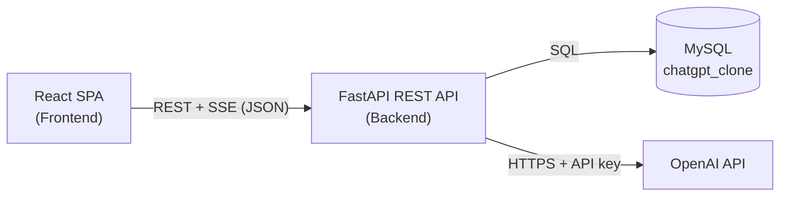
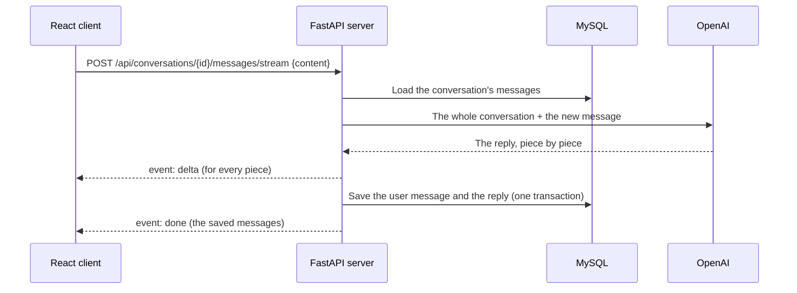
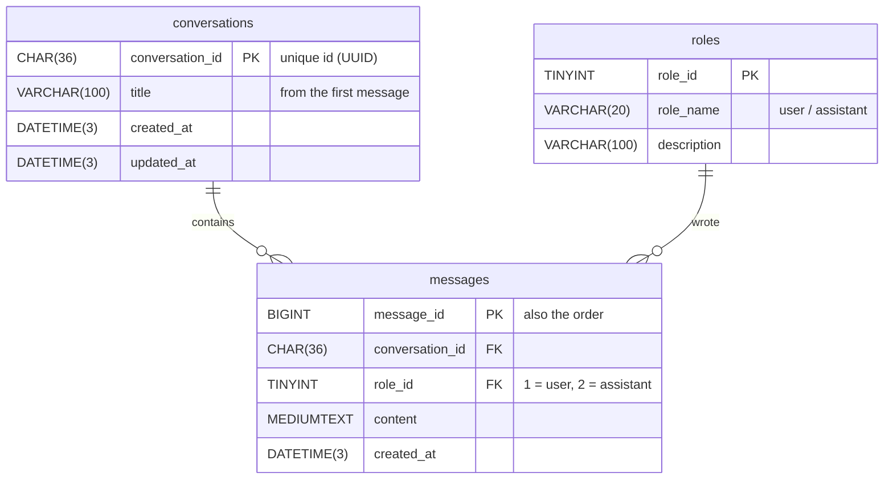

# ChatGPT Clone

A full stack ChatGPT-style web application: chat with an AI assistant, continue the same conversation in context, and come back to previous chats at any time.

**Final project – Full Stack Web Developer course, John Bryce** (Database · Python · REST API · React · GenAI)
Developed by **Itamar Hillel**

## GitHub repository

🔗 **https://github.com/ItamarHillel/chatgpt-clone**

---

## Features

- **Ongoing conversations with context** – every reply is generated from the whole conversation, so the chat remembers what was said earlier.
- **Live streaming replies** – the answer appears word by word (Server-Sent Events) and can be stopped at any moment.
- **New chat** button – starts a new conversation.
- **Chat history** – all conversations are saved in MySQL; reopen or delete any previous chat from the sidebar.
- **Main menu** – navigate between the Home page (the chat) and the About page.
- **Rich formatting** – Markdown replies: lists, tables, and syntax-highlighted code blocks with a copy button.
- **Hebrew & English** – right-to-left text is detected automatically.
- **Responsive** – desktop and mobile layouts, light and dark themes.
- **Secure** – OpenAI is called **only from the server**; the API key is kept in `Backend/.env` and never reaches the browser.

## Technologies

| Layer | Technologies |
|---|---|
| Client | React 19, TypeScript, Vite, React Router, Axios, React Markdown |
| Server | Python, FastAPI, Pydantic, Uvicorn, OpenAI Python SDK (Responses API) |
| Database | MySQL 8 |
| Testing | pytest (backend), Postman collection |

## Architecture



What happens when a message is sent:



## Project structure

```
ItamarHillel/
├── Database/
│   ├── chatgpt_clone.sql          # Database export (structure + sample data) - import this
│   ├── schema.sql                 # The schema only, documented
│   └── docker-compose.yml         # Optional: run MySQL in Docker
├── Backend/                       # Python FastAPI REST API
│   ├── app.py                     # Entry point
│   ├── controllers/               # REST endpoints
│   ├── logic/                     # Business logic
│   ├── services/                  # OpenAI client (the only place that calls OpenAI)
│   ├── dal/                       # Data Access Layer - MySQL connection pool
│   ├── models/                    # Pydantic models and errors
│   ├── utils/                     # Configuration (.env), error handlers, dependencies
│   ├── tests/                     # Automated tests (pytest)
│   ├── requirements.txt           # Python packages
│   ├── requirements-dev.txt       # + packages for running the tests
│   ├── .env.example               # Template for the .env file
│   └── ChatGPT-Clone.postman_collection.json
├── Frontend/                      # React + TypeScript SPA (Vite)
│   └── src/
│       ├── Components/            # LayoutArea, PagesArea, ChatArea, SharedArea
│       ├── Context/               # Chat state (React Context)
│       ├── Models/                # TypeScript models
│       ├── Services/              # REST API calls (axios) and the streaming client (fetch)
│       └── Utils/                 # AppConfig and helpers
├── .gitignore
└── README.md
```

## Database

Database name: **`chatgpt_clone`**



- **Who wrote a message** – every message has a `role_id` that points to the `roles` table: `user` (the user) or `assistant` (the AI chat).
- **Telling conversations apart** – every conversation has a unique id (`conversation_id`, a UUID), and every message belongs to one conversation.
- The view **`conversation_messages_view`** shows all messages in a readable form – conversation id, title, sender (`user` / `assistant`) and text:

```sql
SELECT conversation_id, sender, content, created_at
FROM chatgpt_clone.conversation_messages_view
ORDER BY conversation_id, message_id;
```

Deleting a conversation also deletes its messages (`ON DELETE CASCADE`). All times are stored in UTC.

## REST API

Base URL: `http://localhost:8000/api` · Interactive documentation (Swagger): **http://localhost:8000/docs**

| Method | Endpoint | Description |
|---|---|---|
| `GET` | `/health` | Server, database and OpenAI configuration status |
| `GET` | `/conversations` | All conversations, most recent first |
| `POST` | `/conversations` | Start a new conversation |
| `GET` | `/conversations/{conversationId}` | A conversation with all of its messages |
| `DELETE` | `/conversations/{conversationId}` | Delete a conversation and its messages |
| `POST` | `/conversations/{conversationId}/messages` | Send a message, get the complete reply |
| `POST` | `/conversations/{conversationId}/messages/stream` | Send a message, stream the reply (Server-Sent Events) |

Request body for sending a message: `{ "content": "Tell me a one-liner programming joke" }`

The stream sends `delta` events (`{"content": "..."}`) while the reply is written, and finally `done` (the saved user message and reply) or `error`. Errors always have the form `{"error": "..."}` with a matching status code (404, 422, 502, 503…).

A Postman collection with all the requests and tests is in [`Backend/ChatGPT-Clone.postman_collection.json`](Backend/ChatGPT-Clone.postman_collection.json) (Postman → Import).

## Getting started

### Prerequisites

- Python 3.10+
- Node.js 20+
- MySQL 8 (or Docker)
- An OpenAI API key – https://platform.openai.com/api-keys

### 1. Database

Import `Database/chatgpt_clone.sql` – it creates the `chatgpt_clone` database:

- **MySQL Workbench:** Server → Data Import → *Import from Self-Contained File* → `Database/chatgpt_clone.sql` → Start Import
- **Command line:** `mysql -u root -p < Database/chatgpt_clone.sql`
- **Docker (no local MySQL needed):** `docker compose -f Database/docker-compose.yml up -d`

### 2. Backend

```bash
cd Backend
python -m venv .venv
.venv\Scripts\activate            # Windows   (macOS / Linux: source .venv/bin/activate)
pip install -r requirements.txt
copy .env.example .env            # Windows   (macOS / Linux: cp .env.example .env)
```

Edit `Backend/.env` – set `OPENAI_API_KEY` and the MySQL user / password (`DB_USER`, `DB_PASSWORD`). Then run the server:

```bash
python app.py
```

The API runs on http://localhost:8000 (Swagger docs at http://localhost:8000/docs).

### 3. Frontend

```bash
cd Frontend
npm install
npm run dev
```

Open **http://localhost:3000**

## Configuration (`Backend/.env`)

| Variable | Description | Default |
|---|---|---|
| `OPENAI_API_KEY` | Your OpenAI API key (**required**) | – |
| `OPENAI_MODEL` | The OpenAI model | `gpt-6-luna` |
| `SYSTEM_PROMPT` | Instructions given to the model | `You are a helpful assistant.` |
| `MAX_CONTEXT_MESSAGES` | Previous messages sent to OpenAI as context | `100` |
| `DB_HOST` / `DB_PORT` / `DB_USER` / `DB_PASSWORD` / `DB_NAME` | MySQL connection | `localhost` / `3306` / `root` / – / `chatgpt_clone` |
| `CORS_ORIGINS` | Client addresses allowed to call the API | `http://localhost:3000` |
| `HOST` / `PORT` | Server address | `127.0.0.1` / `8000` |

The `.env` file is listed in `.gitignore` and is never uploaded to GitHub.

## Tests

Backend tests (pytest) – they use the database from `.env` and a fake AI service, so no OpenAI key is needed:

```bash
cd Backend
pip install -r requirements-dev.txt
pytest
```

The Postman collection can also be run from the command line: `npx newman run Backend/ChatGPT-Clone.postman_collection.json`

## Exporting the database

To refresh `Database/chatgpt_clone.sql` with your own conversations:

- **MySQL Workbench:** Server → Data Export → select `chatgpt_clone` → *Dump Structure and Data*, *Export to Self-Contained File*, check *Include Create Schema* → Start Export
- **Command line:**

```bash
mysqldump -u root -p --databases chatgpt_clone --routines --triggers --no-tablespaces > Database/chatgpt_clone.sql
```

## Developer

**Itamar Hillel** – Full Stack Web Developer
GitHub: [ItamarHillel](https://github.com/ItamarHillel)
